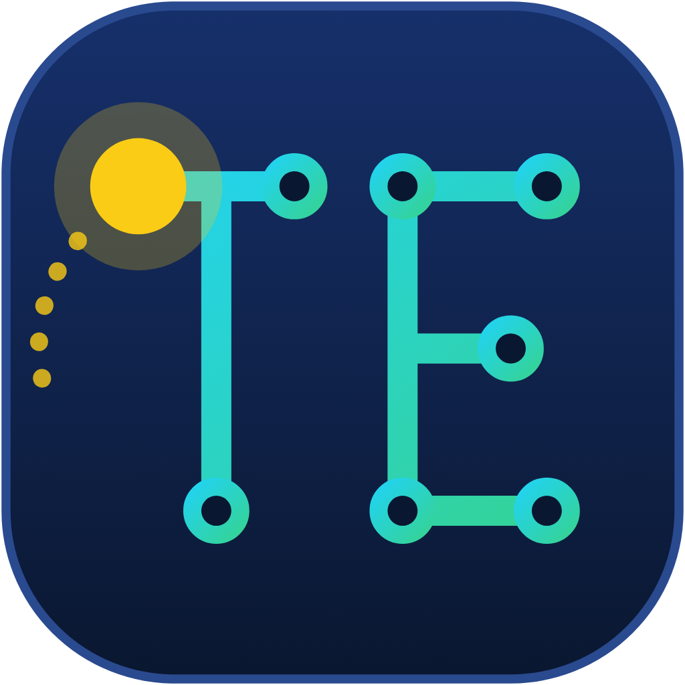

# TraçAÍ Educação — TCC SENAI 2026

<p align="center">
  
</p>

<p align="center">
  <strong>Ferramenta de Alfabetização e Matemática com Visão Computacional</strong><br/>
  TCC — Curso Técnico de Desenvolvimento de Sistemas | SENAI 2026
</p>

<p align="center">
  
  
  
  
</p>

---

## 📥 Como Usar o TraçAÍ Educação

Você pode utilizar o projeto de duas formas, dependendo do seu perfil:

### 🌟 Opção 1: Baixar o Aplicativo Pronto (Recomendado para Usuários e Professores)
> **Não precisa instalar Python, bibliotecas nem o Tesseract!** Tudo já vem embutido em um pacote executável autônomo.

1. Acesse a aba de lançamentos: **[👉 Baixar Instalador Windows (.ZIP) em Releases](https://github.com/mengueu/TCC-SENAI-2026/releases)**;
2. Baixe o arquivo `TracAI_TCC_SENAI_Instalador.zip`;
3. Extraia o arquivo ZIP no seu computador;
4. Dê 2 cliques em `Instalar_TracaAI.bat` (ele criará o atalho na sua Área de Trabalho) ou abra diretamente pelo `TracaAI.exe`.

---

### 💻 Opção 2: Executar pelo Código-Fonte (Para Desenvolvedores e Avaliadores)
Se você deseja inspecionar, modificar ou executar o código em Python:

```bash
# 1. Clone o repositório
git clone https://github.com/mengueu/TCC-SENAI-2026.git
cd TCC-SENAI-2026/versao-ptBR

# 2. Execute o instalador automático de dependências
instalar.bat

# 3. Ou instale manualmente:
python -m venv venv
venv\Scripts\activate
pip install -r requirements.txt
python main.py
```

---

## 🧠 Sobre o Projeto

O **TraçAÍ Educação** é uma aplicação desktop que utiliza visão computacional e inteligência artificial para auxiliar crianças no processo de alfabetização e letramento matemático. 

A criança escreve números e letras **diretamente no ar com o próprio dedo**, na frente da webcam. O sistema reconhece os traços em tempo real, processa a escrita através do Tesseract OCR e fornece retorno pedagógico imediato por texto e síntese de voz (TTS).

**Grupo 8:**  
Miguel Augusto Rocha · Ana Luiza Ferreira Antônio · Maria Luiza Aguilar · Pedro Antunes

---

## 🗂️ Estrutura do Repositório

```
TCC-SENAI-2026/
│
├── README.md                  ← Este guia e visão geral
│
├── versao-ptBR/               ← 🇧🇷 Versão em Português (completa e funcional)
│   ├── main.py                   Ponto de entrada do sistema
│   ├── modules/                  Módulos de visão computacional, OCR, áudio e canvas
│   ├── assets/                   Identidade visual, logos e ícones
│   ├── data/                     Base lexical de nomes brasileiros
│   ├── tessdata/                 Configurações de reconhecimento do OCR
│   ├── requirements.txt          Lista de dependências Python
│   ├── instalar.bat              Script de instalação rápida do ambiente Python
│   └── README.md                 Documentação técnica e pedagógica detalhada
│
└── english-version/           ← 🇺🇸 Versão em Inglês (em breve)
```

---

## Licença

Projeto acadêmico — TCC SENAI 2026. Todos os direitos reservados ao Grupo 8.
