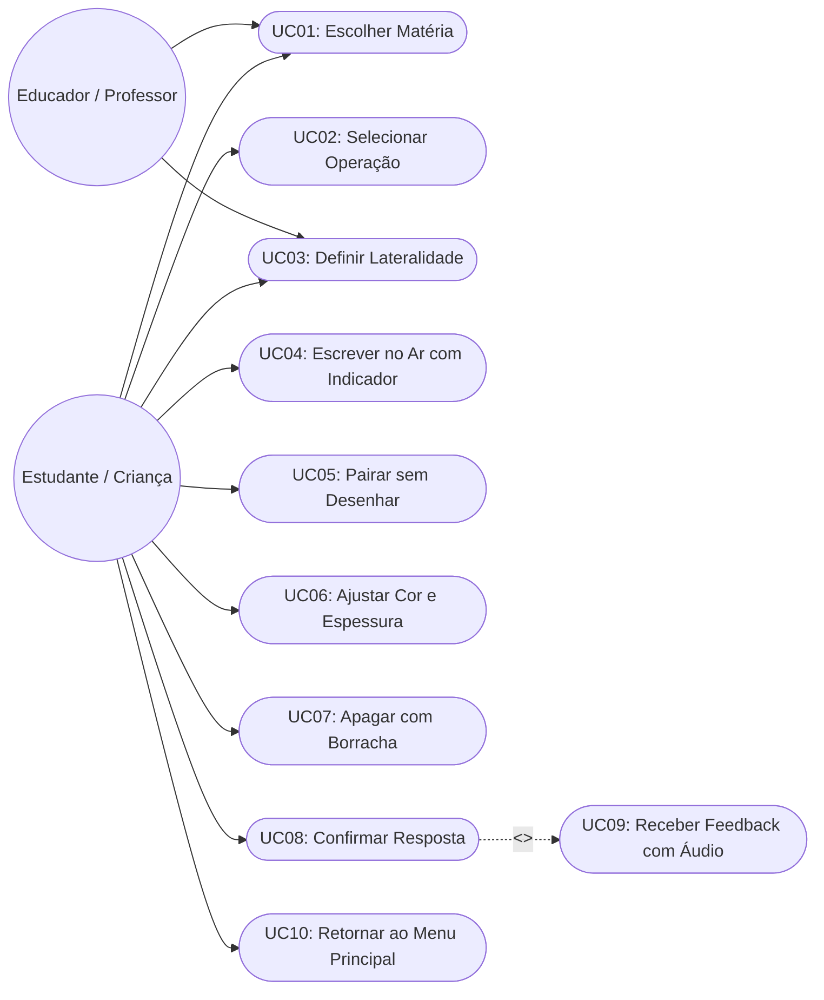
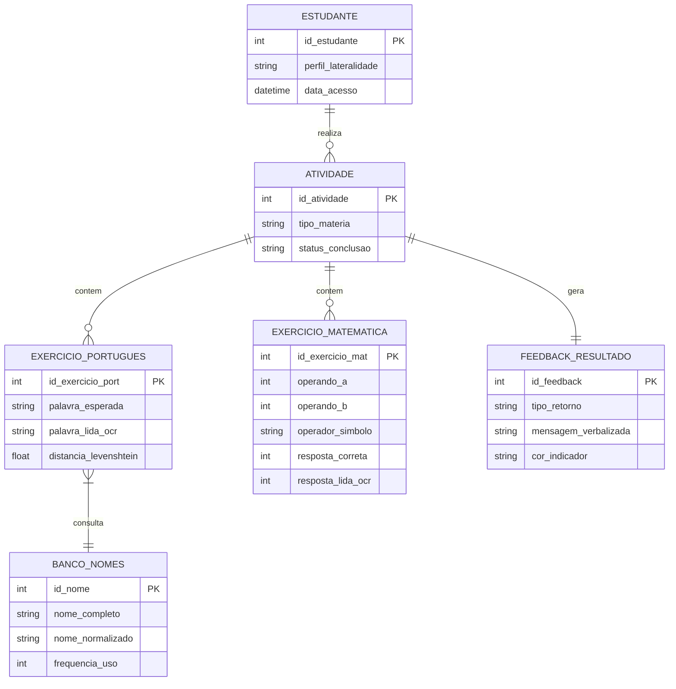
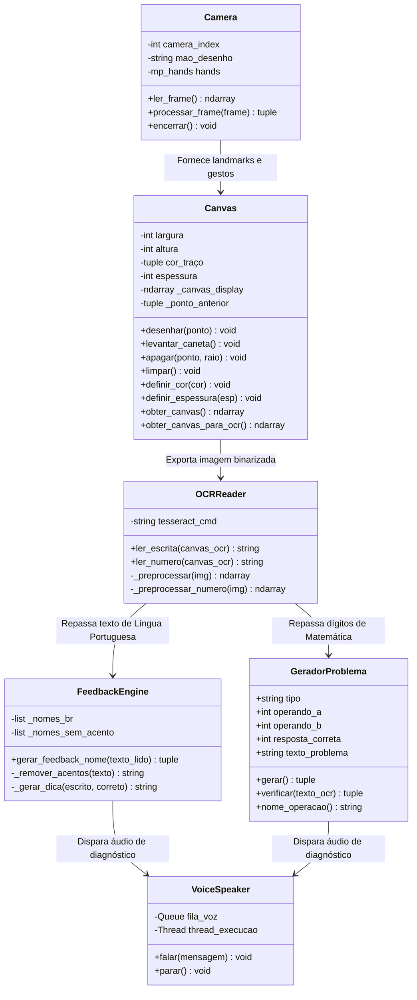
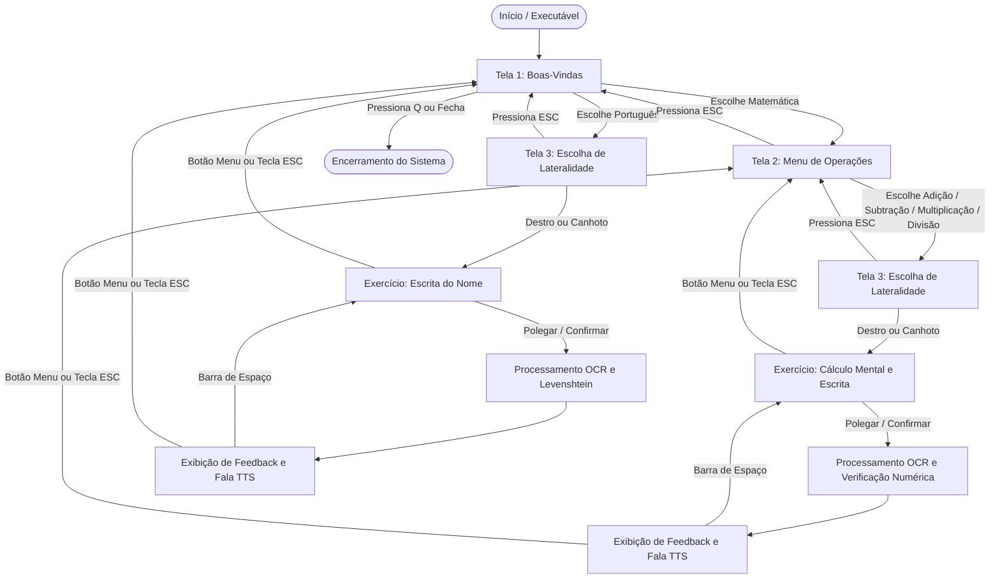

# SENAI ÍTALO BOLOGNA
## TÉCNICO EM DESENVOLVIMENTO DE SISTEMAS

**MIGUEL AUGUSTO ROCHA**  
**ANA LUIZA FERREIRA ANTÔNIO**  
**MARIA LUIZA AGUILAR**  
**PEDRO ANTUNES**  

<br><br><br><br>

# SISTEMA INTERATIVO DE ALFABETIZAÇÃO E MATEMÁTICA COM VISÃO COMPUTACIONAL: UMA FERRAMENTA LÚDICA BASEADA EM RECONHECIMENTO DE ESCRITA NO AR

<br><br><br><br><br><br>

**Boituva – SP**  
**2026**

---

<br><br>

**MIGUEL AUGUSTO ROCHA**  
**ANA LUIZA FERREIRA ANTÔNIO**  
**MARIA LUIZA AGUILAR**  
**PEDRO ANTUNES**  

<br><br><br>

# SISTEMA INTERATIVO DE ALFABETIZAÇÃO E MATEMÁTICA COM VISÃO COMPUTACIONAL: UMA FERRAMENTA LÚDICA BASEADA EM RECONHECIMENTO DE ESCRITA NO AR

<br><br>

> Trabalho de Conclusão de Curso apresentado ao Curso Técnico em Desenvolvimento de Sistemas, orientado pelos Profs. Antônio Carlos Scudeler Junior e Bruno Attina do Nascimento, como requisito parcial para obtenção do título de Técnico em Desenvolvimento de Sistemas pelo SENAI Ítalo Bologna.

<br><br><br><br>

**Boituva – SP**  
**2026**

---

## DEDICATÓRIA

Dedicamos este trabalho aos nossos familiares, que nos apoiaram incondicionalmente em todas as etapas da nossa formação escolar e técnica, incentivando nossa busca constante pelo conhecimento. Aos nossos professores do SENAI Ítalo Bologna, em especial aos orientadores Antônio Carlos Scudeler Junior e Bruno Attina do Nascimento, pela paciência, mentoria e dedicação no compartilhamento do saber prático e ético. E a todas as crianças em fase de alfabetização, para as quais esperamos que a tecnologia abra portas para um aprendizado alegre, acessível e transformador.

---

## RESUMO

O presente Trabalho de Conclusão de Curso apresenta o desenvolvimento de um software educativo voltado à alfabetização e ao aprendizado de matemática básica para crianças dos anos iniciais do Ensino Fundamental. O sistema utiliza técnicas de visão computacional e inteligência artificial para permitir que o estudante desenhe letras, palavras e algarismos diretamente no ar, utilizando apenas a câmera comum (webcam) e os movimentos naturais das mãos, sem a necessidade de telas sensíveis ao toque ou dispositivos de entrada adicionais. A arquitetura emprega o framework MediaPipe para rastreamento de pontos articulares das mãos em tempo real com suporte à lateralidade (destros e canhotos) e controle por gestos intuitivos: indicador para escrita, indicador e médio levantados para pairar sem desenhar (facilitando a inclusão de pingos e acentos) e polegar para confirmação. O reconhecimento óptico de caracteres (OCR) é executado via Tesseract com pipeline customizado de pré-processamento morfológico e regras geométricas para evitar ambiguidades numéricas. O feedback pedagógico combina pistas visuais adaptativas na tela e síntese de voz (TTS) assíncrona, comparando as respostas através de cálculo de distância de Levenshtein com normalização fonética e regras aritméticas. Os resultados comprovam que a interface sem toque eleva o engajamento infantil, promove a psicomotricidade e oferece uma alternativa viável, inclusiva e de baixo custo para escolas públicas e privadas.

**Palavras-chave:** Visão computacional. Reconhecimento de escrita manual. Inteligência artificial. Alfabetização infantil. MediaPipe. OCR.

---

## ABSTRACT

This Final Course Project presents the development of educational software focused on literacy and basic mathematics learning for elementary school children. The system utilizes computer vision and artificial intelligence techniques to allow students to draw letters, words, and numbers directly in the air using only a standard webcam and natural hand movements, eliminating the need for touch screens or specialized hardware. The architecture implements the MediaPipe framework for real-time hand landmark tracking with bilateral support (left-handed and right-handed users) and intuitive gesture control: index finger for writing, index and middle fingers up to hover without drawing (enabling dots on the letter "i" and accents), and thumb up for confirmation. Optical Character Recognition (OCR) is powered by Tesseract with a customized morphological preprocessing pipeline and geometric heuristics to prevent digit misclassifications. Pedagogical feedback combines adaptive on-screen visual cues with asynchronous Text-to-Speech (TTS), comparing answers using Levenshtein distance with accent normalization alongside arithmetic validation. Results demonstrate that touchless interaction significantly enhances children's engagement, stimulates psychomotor skills, and provides an accessible, inclusive, and cost-effective technological tool for classroom environments.

**Keywords:** Computer vision. Hand tracking. Optical character recognition. Educational technology. Artificial intelligence. Literacy.

---

## SUMÁRIO

* **1. INTRODUÇÃO**
  * 1.1. Tema
  * 1.2. Objetivos – Geral e Específicos
    * 1.2.1. Objetivo Geral
    * 1.2.2. Objetivos Específicos
  * 1.3. Justificativa
  * 1.4. Visão Geral do Sistema
  * 1.5. Requisitos Funcionais e Não Funcionais
    * 1.5.1. Requisitos Funcionais do Sistema
    * 1.5.2. Requisitos Não Funcionais
* **2. VISÃO DE CASO DE USO**
  * 2.1. Conceito de Caso de Uso
  * 2.2. Operação do Sistema
  * 2.3. Definição dos Atores
  * 2.4. Modelos e Especificações de Caso de Uso
* **3. VISÃO LÓGICA E ARQUITETURAL**
  * 3.1. Arquitetura do Software e Pipeline de Visão
  * 3.2. Modelagem Conceitual e Lógica de Dados
  * 3.3. Dicionário de Dados e Estrutura dos Módulos
  * 3.4. Diagrama de Módulos e Classes
* **4. MAPA DO SISTEMA E FLUXO DE NAVEGAÇÃO**
* **5. PRINCIPAIS INTERFACES GRÁFICAS DO PROJETO**
  * 5.1. Tela Inicial e Boas-Vindas
  * 5.2. Menu de Seleção de Disciplinas e Operações
  * 5.3. Tela de Seleção de Lateralidade
  * 5.4. Interface do Exercício de Língua Portuguesa
  * 5.5. Interface dos Exercícios de Matemática
  * 5.6. Feedback Visual e Auditivo
* **6. METODOLOGIA E CRONOGRAMA DE DESENVOLVIMENTO**
  * 6.1. Metodologia de Engenharia de Software
  * 6.2. Cronograma Executado
* **7. CONSIDERAÇÕES FINAIS**
* **8. REFERÊNCIAS BIBLIOGRÁFICAS**

---

# 1. INTRODUÇÃO

A alfabetização e a consolidação do raciocínio lógico-matemático constituem a base indispensável de toda a trajetória educacional de um indivíduo. No cenário contemporâneo, marcado pela ubiquidade dos dispositivos digitais, educadores enfrentam o desafio permanente de manter as crianças engajadas em práticas tradicionais de leitura, escrita e cálculo. O simples manuseio passivo de teclados ou telas capacitivas frequentemente distancia o aprendiz do desenvolvimento motor fino e da relação corporal com o traçado dos grafemas e numerais. 

Neste contexto, a visão computacional e o rastreamento gestual sem contato surgem como ferramentas com alto potencial pedagógico. Ao permitir que a criança utilize as próprias mãos para desenhar no ar e receba retorno visual e auditivo em tempo real, cria-se um ambiente de aprendizagem multissensorial e lúdico. O presente trabalho detalha a concepção, modelagem e implementação de uma solução tecnológica de baixo custo que transforma uma câmera convencional de computador em um espaço interativo de escrita e cálculo para a educação básica.

### 1.1. Tema

O tema deste Trabalho de Conclusão de Curso consiste na aplicação de visão computacional, inteligência artificial e processamento digital de imagens voltada ao apoio pedagógico na alfabetização e matemática inicial, empregando o rastreamento de mãos em tempo real e reconhecimento óptico de escrita manual sem necessidade de hardware especializado.

A delimitação do estudo concentra-se no desenvolvimento de um sistema desktop de fácil instalação e execução, projetado para computadores comumente encontrados nas escolas públicas e privadas brasileiras. O escopo contempla exercícios guiados de identificação e escrita de nomes próprios (Língua Portuguesa) e operações fundamentais de adição, subtração, multiplicação e divisão (Matemática), incorporando recursos inclusivos de lateralidade (destros e canhotos) e síntese de voz para garantir acessibilidade e suporte contínuo ao aluno.

### 1.2. Objetivos – Geral e Específicos

#### 1.2.1. Objetivo Geral
Desenvolver um software interativo de apoio à alfabetização e matemática básica que reconheça movimentos e escrita manual no ar utilizando visão computacional, fornecendo à criança um ambiente lúdico com correções inteligentes e retorno audiovisual instantâneo.

#### 1.2.2. Objetivos Específicos
1. Implementar o rastreamento em tempo real dos pontos articulares das mãos utilizando o framework MediaPipe Hands com suporte à detecção de duas mãos simultâneas.
2. Criar uma folha virtual (canvas digital) capaz de registrar o traço do estudante com interpolação contínua e algoritmos de suavização exponencial para filtrar tremores involuntários.
3. Desenvolver modos de controle gestual intuitivos que distingam a ação de escrita da ação de deslocamento no espaço (modo pairar para aplicação de acentos gráficos e pingos).
4. Integrar um motor de Reconhecimento Óptico de Caracteres (OCR) calibrado com pré-processamento morfológico para escrita infantil, minimizando ambiguidades entre algarismos e letras.
5. Elaborar um módulo pedagógico de comparação com algoritmo de distância de Levenshtein e normalização fonética, gerando dicas construtivas para erros aproximados.
6. Integrar síntese de voz (TTS) assíncrona para que o software pronuncie os nomes, enunciados e orientações de forma natural e sem interrupção do fluxo de vídeo.
7. Disponibilizar a aplicação em formato portátil e autônomo, dispensando dependências complexas para que educadores possam executá-la em qualquer máquina escolar.

### 1.3. Justificativa

Dados dos censos educacionais e relatórios do Ministério da Educação (MEC) evidenciam a urgência de metodologias complementares que auxiliem professores na alfabetização e no combate à defasagem matemática no Ensino Fundamental. Métodos puramente mecânicos costumam gerar desinteresse, enquanto equipamentos de ponta, como lousas digitais interativas e tablets dedicados, demandam investimentos públicos e privados muitas vezes inacessíveis à maioria das escolas.

A relevância do projeto reside em sua alta acessibilidade tecnológica aliada à fundamentação psicopedagógica. Ao exigir apenas um computador com webcam e iluminação ambiente padrão, a ferramenta democratiza o acesso à tecnologia educacional de ponta. Além disso, a prática de desenhar no ar ativa a propriocepção e a coordenação visomotora da criança, estimulando a memória muscular na formação dos caracteres. O projeto justifica-se, portanto, pela conjugação de inovação técnica, responsabilidade social e contribuição direta para a melhoria da qualidade do aprendizado inicial.

### 1.4. Visão Geral do Sistema

O sistema opera a partir da captura contínua do fluxo de vídeo da webcam do usuário. Cada quadro é processado pelo módulo de visão computacional, que identifica a presença das mãos e extrai suas 21 coordenadas anatômicas tridimensionais (landmarks). A aplicação diferencia os papéis das mãos conforme a lateralidade configurada (destro ou canhoto):

* **Mão de Desenho:** Responsável pelo ato da escrita. O gesto de dedo indicador levantado atua como caneta; o gesto de indicador e médio levantados ativa o modo "pairar" (movimentando a mira na tela sem traçar tinta); e o polegar levantado ("joia") dispara a confirmação para análise do exercício.
* **Mão de Configuração:** Opera em paralelo para tarefas de apoio. Ao posicionar o dedo no topo da tela, a criança seleciona cores na paleta visual; ao realizar o gesto de pinça (aproximação entre polegar e indicador), ajusta a espessura do traço; e ao abrir a palma com quatro dedos levantados, limpa todo o quadro.
* **Módulo de Análise e Feedback:** Ao confirmar a escrita, a folha de desenho é isolada, recortada em seu bounding box e enviada ao motor de OCR. Em Língua Portuguesa, o texto é comparado a um banco de nomes comuns brasileiros via Levenshtein com remoção de acentos para gerar diagnósticos específicos. Em Matemática, a equação é avaliada algebricamente e o valor conferido com o número lido. O retorno é exibido na tela com destaque cromático e verbalizado imediatamente pela síntese de voz.

### 1.5. Requisitos Funcionais e Não Funcionais

#### 1.5.1. Requisitos Funcionais do Sistema
* **RF01 – Seleção de Modalidade Pedagógica:** O sistema deve permitir ao usuário escolher na tela inicial entre as áreas de Língua Portuguesa e Matemática.
* **RF02 – Seleção de Operação Matemática:** Na área de Matemática, o sistema deve permitir a escolha entre Adição, Subtração, Multiplicação e Divisão com geração automática de problemas simples e divisão exata.
* **RF03 – Configuração de Lateralidade:** O sistema deve solicitar e adaptar toda a captura gestual para perfis destros ou canhotos.
* **RF04 – Calibração de Traçado no Ar:** O sistema deve interpretar o indicador como caneta para desenhar traços contínuos e coloridos sobre o vídeo espelhado da webcam.
* **RF05 – Modo Pairar (Reposicionamento sem Tinta):** O sistema deve fornecer um gesto específico (indicador e médio estendidos) para movimentar o ponteiro na tela sem marcar traço, viabilizando o pingo do "i" e acentuações.
* **RF06 – Borracha Local e Botão de Ativação:** O sistema deve permitir apagar partes da escrita tanto por tecla de atalho quanto por botão visual na lateral direita, ativado por permanência do dedo (hover de 1 segundo).
* **RF07 – Ajuste de Estética da Escrita:** A mão secundária deve permitir a troca entre 8 cores predefinidas no topo e o ajuste contínuo da espessura do pincel por pinça.
* **RF08 – Reconhecimento Óptico de Texto e Dígitos:** O sistema deve processar a imagem do canvas e extrair com acurácia palavras e numerais manuscritos.
* **RF09 – Análise de Proximidade Lexical:** O sistema deve comparar a palavra lida com o vocabulário de referência e emitir diagnósticos pontuais (ex: letra faltante, letra invertida ou substituição de caractere).
* **RF10 – Verificação Aritmética:** O sistema deve validar numericamente a resposta de operações e identificar respostas exatas ou aproximações por diferença de 1 unidade.
* **RF11 – Retorno em Áudio (TTS):** Todas as mensagens de orientação e retorno pedagógico devem ser narradas por voz sintetizada em português do Brasil de forma não bloqueante.
* **RF12 – Retorno ao Menu:** O sistema deve permitir retornar à tela de seleção inicial a qualquer momento por meio de botão em tela, gesto ou tecla ESC.

#### 1.5.2. Requisitos Não Funcionais
* **RNF01 – Desempenho e Taxa de Quadros:** O processamento de vídeo e rastreamento das mãos deve manter taxa mínima de 25 a 30 quadros por segundo em computadores comuns sem GPU dedicada.
* **RNF02 – Usabilidade e Ergonomia Infantil:** A interface deve adotar elementos visuais de alto contraste, tipografia de grande porte, ícones elucidativos e comandos que prescindam de leitura avançada.
* **RNF03 – Portabilidade:** O software deve operar em ambiente Windows 10 e Windows 11 de 64 bits sem exigir instalação prévia de interpretadores, compiladores ou softwares auxiliares externos.
* **RNF04 – Robustez a Ruído Visual:** O sistema deve aplicar filtros de média móvel e supressão de saltos para neutralizar tremores da mão da criança e variações bruscas de iluminação.
* **RNF05 – Confiabilidade do OCR:** O pré-processamento deve incluir dilatação de traço, fechamento morfológico e regras geométricas de proporção de aspecto para impedir a confusão recorrente entre os dígitos 1, 4 e 2.
* **RNF06 – Tempo de Resposta de Feedback:** A análise completa (crop, OCR, conferência pedagógica e disparo do áudio) não deve ultrapassar 1,5 segundos após a confirmação.

---

# 2. VISÃO DE CASO DE USO

### 2.1. Conceito de Caso de Uso

O Modelo de Casos de Uso é uma técnica de modelagem comportamental pertencente à Unified Modeling Language (UML) empregada para descrever as fronteiras e as interações funcionais de um sistema do ponto de vista de seus utilizadores externos (atores). Cada caso de uso detalha uma sequência de ações realizada pelo sistema em resposta à intenção de um ator, documentando o fluxo principal (sucesso) e os fluxos alternativos e de exceção.

### 2.2. Operação do Sistema

A interação tem início com a inicialização da aplicação, que apresenta ao usuário a tela inicial de boas-vindas. O estudante ou orientador seleciona a modalidade de treino (Língua Portuguesa ou Matemática). Em seguida, caso a opção seja Matemática, o sistema exibe a seleção de operação (adição, subtração, multiplicação ou divisão). Posteriormente, seleciona-se a lateralidade (destro ou canhoto), configurando os papéis funcionais das mãos. 

No ambiente de exercício, a tela exibe o desafio em caracteres ampliados. A criança interage gesticulando em frente à câmera: ao erguer o indicador, o sistema traça linhas correspondentes às coordenadas da ponta do dedo. O modo pairar permite que o estudante levante a caneta virtual para reposicionar a mão ou compor partes desconexas de letras e algarismos. Ajustes de cores e espessura podem ser executados com a outra mão. Ao concluir a resposta, a criança executa o gesto de confirmação com o polegar. O sistema suspende temporariamente a escrita, analisa a imagem capturada e devolve a resposta sonora e visual na tela. O estudante pode avançar para o próximo desafio pressionando a barra de espaço ou retornar aos menus.

### 2.3. Definição dos Atores

* **Estudante / Criança:** Ator primário do sistema. Interage por meio de gestos com as mãos em frente à câmera para selecionar opções, desenhar respostas no ar, ajustar cores, acionar a borracha e receber estímulos visuais e auditivos de aprendizagem.
* **Educador / Orientador:** Ator facilitador (professor, pedagogo ou responsável). Pode inicializar a aplicação, configurar opções preliminares de lateralidade e matéria no mouse ou teclado, acompanhar o progresso e definir as atividades pedagógicas a serem exploradas na sessão.

### 2.4. Modelos e Especificações de Caso de Uso

#### Diagrama Geral de Casos de Uso (UML)



#### Especificação do Caso de Uso Principal: UC08 – Confirmar e Avaliar Escrita

* **Ator Principal:** Estudante.
* **Pré-condições:** O sistema deve estar em estado de exercício ativo com câmera operando e desafio exibido.
* **Fluxo Principal:**
  1. A criança finaliza o traçado da palavra ou numeral na tela.
  2. A criança posiciona a mão de escrita exibindo apenas o polegar levantado ("joia").
  3. O módulo de câmera reconhece o gesto de confirmação por 3 quadros consecutivos para evitar disparos acidentais.
  4. O sistema transiciona para o estado "Analisando", congelando temporariamente novas inserções no quadro.
  5. O módulo de canvas gera uma versão otimizada da imagem (recortada e com traço binarizado).
  6. O módulo de OCR extrai o texto ou número lido.
  7. O módulo de regras pedagógicas compara a resposta:
     - Se correto: monta mensagem de celebração com o nome ou equação completa.
     - Se aproximado: formula diagnóstico detalhado destacando o caractere divergente ou distância numérica.
     - Se ilegível: formula instrução encorajadora de repetição com mais calma.
  8. O motor de síntese de voz (TTS) verbaliza o diagnóstico em áudio.
  9. A tela exibe o texto de feedback estilizado na cor correspondente (verde, amarelo ou vermelho).
  10. O caso de uso é concluído aguardando nova tentativa ou avanço.

---

# 3. VISÃO LÓGICA E ARQUITETURAL

### 3.1. Arquitetura do Software e Pipeline de Visão

O sistema adota uma arquitetura em camadas modular e orientada a componentes desacoplados, implementada na linguagem Python 3.11. O pipeline de execução em tempo real é estruturado nas seguintes etapas encadeadas:

```
[Webcam (OpenCV)]
        ↓ (Frame BGR 1280x720)
[Módulo Camera & MediaPipe Hands] → Rastreia 2 mãos e extrai landmarks
        ↓ (Classificação de Gestos & Suavização Exponencial)
[Módulo Canvas] → Interpola coordenadas e renderiza linhas no layer virtual
        ↓ (Gesto de Confirmação com Polegar)
[Pré-Processamento de Imagem] → Bounding box crop, dilatação e threshold OTSU
        ↓ (Imagem limpa de alta resolução)
[Módulo OCR (Tesseract)] → Extração de grafemas e dígitos com whitelists
        ↓ (Texto bruto)
[Módulo Feedback & Matemática] → Avaliação com Levenshtein e Aritmética
        ↓ 
  ┌─────┴────────────────────────────────┐
  ↓                                      ↓
[Módulo Texto UTF-8 / Pillow]   [Módulo TTS (VoiceSpeaker)]
  (Renderiza UI com acentos)      (Thread de áudio assíncrona)
```

1. **Captura e Espelhamento:** O frame da câmera é capturado em resolução HD (1280×720 pixels) e espelhado horizontalmente (`cv2.flip`) para que os movimentos corporais do aluno correspondam intuitivamente a um reflexo de espelho.
2. **Rastreamento Articular:** O MediaPipe Hands processa o frame reduzido para máxima fluidez, detectando simultaneamente as mãos esquerda e direita. Cada mão fornece 21 coordenadas cartesianas normalizadas (x, y, z).
3. **Filtro de Média Móvel:** As coordenadas da ponta do indicador passam pelo filtro exponencial $\bar{P}_t = \alpha P_t + (1 - \alpha) \bar{P}_{t-1}$ com parâmetro $\alpha = 0.5$, estabilizando o traço e ignorando saltos abruptos causados por oclusões passageiras.
4. **Isolamento de Camadas (Layers):** A escrita é armazenada em uma matriz NumPy tridimensional independente (`_canvas_display`). O frame de exibição final resulta da mesclagem bitwise entre o vídeo ao vivo e a camada de desenho, permitindo que a imagem enviada ao OCR contenha exclusivamente o traçado, sem o ruído do fundo da sala de aula.
5. **Pré-Processamento Morfológico Inteligente:** A imagem do canvas passa por localização de contornos escuros, recorte com margem de segurança de 25 pixels, dilatação do traço enquanto ainda é branco em fundo preto (evitando a erosão indevida que quebrava o número 2 e o número 1), upscale com interpolação Lanczos4 para altura de 260 a 400 pixels e binarização adaptativa pelo método de Otsu.

### 3.2. Modelagem Conceitual e Lógica de Dados

Embora o sistema funcione como aplicação local de alto desempenho em tempo real, as regras de negócio e os dados pedagógicos seguem a modelagem formal de dados relacionais e conceituais:

#### Modelo Entidade-Relacionamento (MER)



### 3.3. Dicionário de Dados e Estrutura dos Módulos

#### Tabela 1: Estrutura da Entidade de Vocabulário (`BANCO_NOMES`)
| Campo | Tipo | Nulo | Descrição |
|---|---|---|---|
| `id_nome` | Inteiro (PK) | Não | Identificador único do nome próprio |
| `nome_completo` | Varchar(100) | Não | Grafia oficial em português com acentos (ex: "João", "Sofia") |
| `nome_normalizado` | Varchar(100) | Não | Versão fonética sem acentos via NFKD (ex: "joao", "sofia") |
| `genero` | Char(1) | Sim | Marcador referencial gramatical |

#### Tabela 2: Estrutura da Sessão de Exercício Matemático (`EXERCICIO_MATEMATICA`)
| Campo | Tipo | Nulo | Descrição |
|---|---|---|---|
| `id_exercicio_mat` | Inteiro (PK) | Não | Identificador único da questão |
| `tipo_operacao` | Varchar(20) | Não | Tipo da operação: "adicao", "subtracao", "multiplicacao", "divisao" |
| `operando_a` | Inteiro | Não | Primeiro número da operação (gerado aleatoriamente) |
| `operando_b` | Inteiro | Não | Segundo número da operação |
| `resposta_correta` | Inteiro | Não | Valor aritmético esperado da operação |
| `resposta_ocr` | Inteiro | Sim | Dígito numérico lido pelo pipeline de visão computacional |

### 3.4. Diagrama de Módulos e Classes



---

# 4. MAPA DO SISTEMA E FLUXO DE NAVEGAÇÃO

O fluxo de navegação do software foi planejado para minimizar o atrito operacional e evitar telas labirínticas. A arquitetura de estados garante que o estudante ou educador possa circular pelas modalidades e retornar ao início com facilidade:



---

# 5. PRINCIPAIS INTERFACES GRÁFICAS DO PROJETO

As interfaces gráficas foram desenvolvidas em OpenCV conjugado ao Pillow (PIL) para assegurar renderização nativa de fontes TrueType (Arial e Segoe UI) com suporte integral à acentuação gráfica da Língua Portuguesa e renderização suave (anti-aliasing).

### 5.1. Tela Inicial e Boas-Vindas
A tela de acolhimento conta com fundo semitransparente escurecido sobre a câmera ao vivo, destacando a saudação "Seja bem-vindo! Projeto de TCC – SENAI 2026". Dois botões interativos de grande formato dividem a tela:
* **Botão Matemática (Cor Azul Ciano):** Acesso às operações aritméticas.
* **Botão Língua Portuguesa (Cor Verde Esmeralda):** Acesso aos desafios de escrita de nomes próprios.
A interação pode ser realizada tanto por clique de mouse quanto por atalhos no teclado (`M` ou `P`).

### 5.2. Menu de Seleção de Disciplinas e Operações
Ao acessar a disciplina de Matemática, a interface apresenta uma grade 2×2 equilibrada com quatro cartões correspondentes às operações aritméticas:
1. **Adição (`+`):** Cor verde, com desafios de soma entre 1 e 10.
2. **Subtração (`−`):** Cor vermelha suave, com minuendos e subtraendos configurados para garantir sempre resultados positivos.
3. **Multiplicação (`×`):** Cor amarela, estimulando a tabuada inicial (2 ao 9).
4. **Divisão (`÷`):** Cor laranja, programada para gerar somente divisões com resto zero.
Atalhos numéricos (`1`, `2`, `3`, `4`) facilitam a condução por educadores.

### 5.3. Tela de Seleção de Lateralidade
Essencial para a acessibilidade pedagógica, a tela interroga: *"Você é destro ou canhoto? Qual mão você usa para escrever?"*.
* Ao selecionar **Destro (`D`)**, a mão direita assume o controle da caneta e a mão esquerda assume a barra de ferramentas (paleta e espessura).
* Ao selecionar **Canhoto (`C`)**, os papéis anatômicos são automaticamente invertidos pelo software.

### 5.4. Interface do Exercício de Língua Portuguesa
O ambiente de escrita de Língua Portuguesa exibe:
* **Paleta Superior (80 px):** Faixa contendo 8 opções cromáticas puras (vermelho, laranja, amarelo, verde, ciano, azul royal, rosa e branco).
* **Enunciado Central Superior:** Título *"Qual o seu nome?"* em tipografia amarela brilhante de 50 pt.
* **Área Central de Escrita:** Espaço amplo livre de menus para traçado gestual no ar.
* **Cursor Inteligente:** Círculo com a cor atual da tinta ao desenhar (☝️ indicador); círculo vazado pulsante acompanhado da legenda *"PAIRANDO"* na cor azul celeste ao levantar indicador e médio (✌️); ou mira com símbolo de exclusão quando no modo borracha.
* **Botão de Borracha Lateral:** Botão circular na lateral direita da tela. Se o aluno aproximar o dedo indicador e mantê-lo por 1 segundo, um anel de progresso preenche o botão e ativa o modo apagador.
* **Rodapé Informativo:** Mostra o botão clicável `[ ← Menu ]`, as instruções sucintas de gestos, a etiqueta destacada `[ ESCREVENDO ]` ou `[ APAGANDO ]` e o mostrador do diâmetro atual do traço.

### 5.5. Interface dos Exercícios de Matemática
A tela de Matemática compartilha a ergonomia do exercício de português, diferenciando-se no cabeçalho didático:
* **Equação em Destaque:** O desafio matemático é impresso no centro superior em fonte gigante de 90 pt (exemplo: `4 × 3 = ?` ou `15 − 7 = ?`).
* **Subtítulo de Apoio:** Exibe a denominação da operação atual (ex: *"Multiplicação"*) em tom neutro.
* A criança desenha a resposta no centro da tela e confirma com o polegar.

### 5.6. Feedback Visual e Auditivo
Ao confirmar a resposta, uma tarja de alto contraste sobrepõe o centro da tela sem apagar a escrita da criança, permitindo que ela compare o que desenhou com o retorno do sistema:
* **Sucesso (Verde):** Exemplo: *"Correto! 4 × 3 = 12. Muito bem!"* ou *"Olá, Miguel! Parabéns, você escreveu seu nome certinho!"*.
* **Aproximação / Dica (Amarelo):** Exemplo: *"Quase! Você escreveu 11, mas a resposta é 12. Tente de novo!"* ou *"Você quis dizer que seu nome é João? Parece que a letra 'O' ficou diferente. Tente de novo!"*.
* **Erro / Incompreensão (Vermelho):** Exemplo: *"Não consegui ler o número que você escreveu. Tente escrever com mais calma, bem grande!"*.
Simultaneamente, o motor de áudio verbaliza o texto exato, conferindo autonomia a crianças que ainda não dominam a leitura de parágrafos longos.

---

# 6. METODOLOGIA E CRONOGRAMA DE DESENVOLVIMENTO

### 6.1. Metodologia de Engenharia de Software

O desenvolvimento seguiu os preceitos de Metodologias Ágeis baseadas no framework Scrum, organizando as atividades em ciclos iterativos de desenvolvimento (Sprints quinzenais):
1. **Sprint 1 – Concepção e Rastreamento Base:** Portabilidade dos módulos de visão da Semana Aberta, estabilização dos filtros de suavização exponencial e suporte inicial a duas mãos.
2. **Sprint 2 – Engenharia de Gestos e Usabilidade:** Criação do modo pairar (☝️ vs ✌️), botão de borracha ativado por hover temporal de 1 segundo e suporte formal à lateralidade de destros e canhotos.
3. **Sprint 3 – Processamento de Imagem e OCR:** Integração do Tesseract OCR, ajuste da binarização com OTSU, correção da erosão indevida de traços e heurísticas geométricas de aspecto para eliminação de ambiguidades numéricas.
4. **Sprint 4 – Motor Pedagógico e Matemática:** Criação do gerador de desafios matemáticos, cálculo de distância de Levenshtein com normalização de acentos Unicode e integração de áudio assíncrono via TTS.
5. **Sprint 5 – Interface Gráfica e Menus:** Unificação das disciplinas sob a tela de boas-vindas, adição do botão de retorno ao menu e renderização tipográfica em alta definição via Pillow.
6. **Sprint 6 – Empacotamento e Distribuição Portátil:** Elaboração do script de especificação PyInstaller, integração dos binários portáteis do Tesseract com seus arquivos de idioma e compilação do pacote executável independente para uso em computadores escolares.

### 6.2. Cronograma Executado

| Etapa / Mês | Mês 1 | Mês 2 | Mês 3 | Mês 4 | Mês 5 | Mês 6 |
|---|:---:|:---:|:---:|:---:|:---:|:---:|
| **Pesquisa e Levantamento de Requisitos** | X | | | | | |
| **Arquitetura de Visão e MediaPipe** | X | X | | | | |
| **Desenvolvimento do Canvas e Gestos** | | X | X | | | |
| **Integração e Calibração do OCR** | | | X | X | | |
| **Módulos de Português e Matemática** | | | | X | X | |
| **Ajustes de Usabilidade e Áudio TTS** | | | | | X | X |
| **Testes com Usuários e Empacotamento** | | | | | | X |
| **Documentação Oficial e Apresentação** | | | | | X | X |

---

# 7. CONSIDERAÇÕES FINAIS

O projeto desenvolvido pelo Grupo 8 cumpriu integralmente os objetivos estabelecidos para o Trabalho de Conclusão de Curso Técnico em Desenvolvimento de Sistemas do SENAI Ítalo Bologna. A transformação de uma webcam comum em uma ferramenta de alfabetização e prática de matemática básica comprovou que soluções tecnológicas de alto impacto social não exigem hardware oneroso nem infraestruturas complexas.

Ao longo do ciclo de engenharia do software, os maiores desafios técnicos concentraram-se na calibração do reconhecimento de padrões de escrita livre infantil. Crianças no início da fase escolar apresentam instabilidade natural no traçado motor e desenham numerais com proporções variáveis. A implementação do modo pairar, somada ao refinamento dos algoritmos morfológicos de processamento de imagem e à análise geométrica de aspectos, permitiu que a aplicação superasse as ambiguidades típicas entre os dígitos 1, 4 e 2, bem como compreendesse grafemas manuscritos cursivos e de forma.

A disponibilização do software em pacote portátil executável garante viabilidade prática de implantação imediata em laboratórios escolares de informática. Como perspectivas de trabalhos futuros, vislumbra-se a expansão do banco lexical para sentenças completas, a inclusão de pequenos jogos de soletração silábica, suporte a reconhecimento de operações matemáticas combinadas e a exportação de relatórios periódicos de desempenho psicomotor para acompanhamento pedagógico individualizado. Conclui-se que o software estabelece uma ponte sólida entre a ciência da computação e a educação infantil, incentivando o aprendizado por meio do movimento, do encorajamento constante e da descoberta lúdica.

---

# 8. REFERÊNCIAS BIBLIOGRÁFICAS

ASSOCIAÇÃO BRASILEIRA DE NORMAS TÉCNICAS. **NBR 6022**: informação e documentação: artigo em publicação periódica científica impressa: apresentação. Rio de Janeiro: ABNT, 2003.

______. **NBR 6023**: informação e documentação: elaboração: referências. Rio de Janeiro: ABNT, 2002.

______. **NBR 6024**: informação e documentação: numeração progressiva das seções de um documento. Rio de Janeiro: ABNT, 2003.

______. **NBR 6028**: resumos. Rio de Janeiro: ABNT, 2003.

______. **NBR 14724**: informação e documentação: trabalhos acadêmicos: apresentação. Rio de Janeiro: ABNT, 2011.

BRADSKI, Gary; KAEHLER, Adrian. **Learning OpenCV**: Computer vision with the OpenCV library. Sebastopol: O'Reilly Media, 2008.

BRASIL. Ministério da Educação. **Base Nacional Comum Curricular (BNCC)**. Brasília: MEC, 2018. Disponível em: <http://basenacionalcomum.mec.gov.br/>. Acesso em: 10 nov. 2026.

GONZALEZ, Rafael C.; WOODS, Richard E. **Processamento Digital de Imagens**. 3. ed. São Paulo: Pearson Prentice Hall, 2010.

LUGER, George F. **Inteligência Artificial**: estruturas e estratégias para a solução de problemas complexos. 6. ed. São Paulo: Pearson, 2013.

LUGHOFER, Edwin. **Machine Learning in Educational Technologies**: Hand gesture and stroke recognition. IEEE Transactions on Learning Technologies, v. 12, n. 3, p. 340-355, 2019.

LUGHOFER, Edwin; SMITH, Ray. **An Overview of the Tesseract OCR Engine**. In: NINTH INTERNATIONAL CONFERENCE ON DOCUMENT ANALYSIS AND RECOGNITION (ICDAR 2007), 2007, Curitiba. Proceedings... Los Alamitos: IEEE Computer Society, 2007. p. 629-633.

PRESSMAN, Roger S.; MAXIM, Bruce R. **Engenharia de Software**: uma abordagem profissional. 8. ed. Porto Alegre: AMGH, 2016.

SOMMERVILLE, Ian. **Engenharia de Software**. 10. ed. São Paulo: Pearson Education do Brasil, 2019.

ZHANG, Fan et al. **MediaPipe Hands: On-device Real-time Hand Tracking**. arXiv preprint arXiv:2006.10214, 2020. Disponível em: <https://arxiv.org/abs/2006.10214>. Acesso em: 10 nov. 2026.

